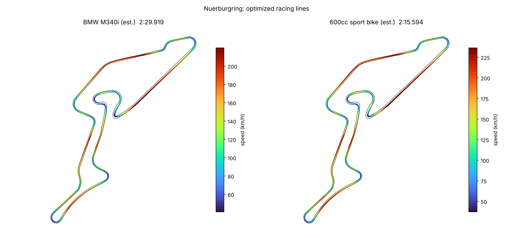
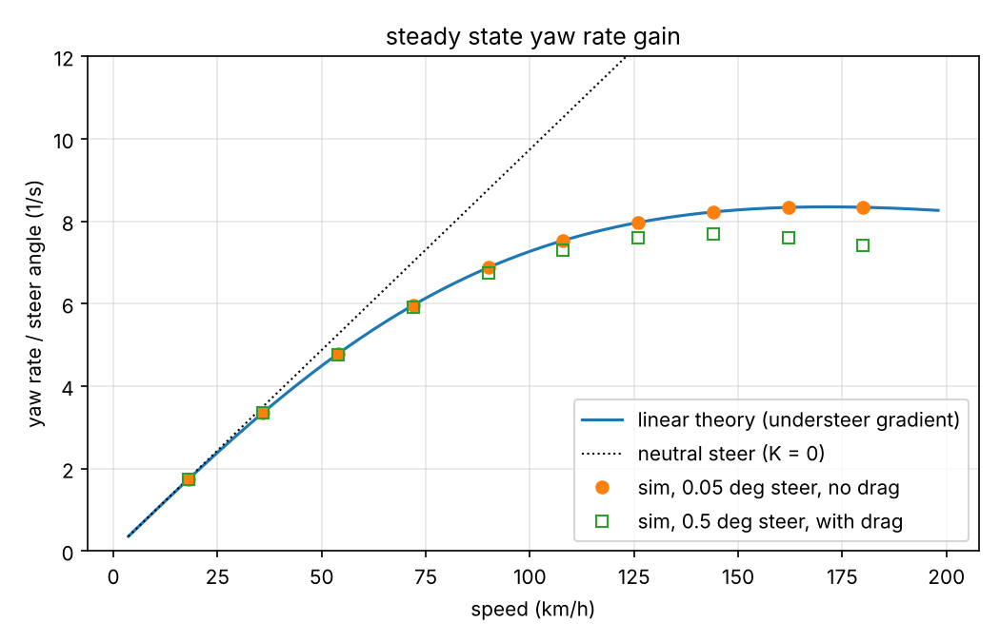
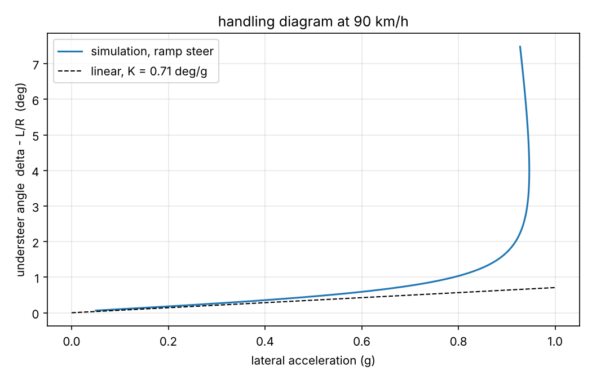
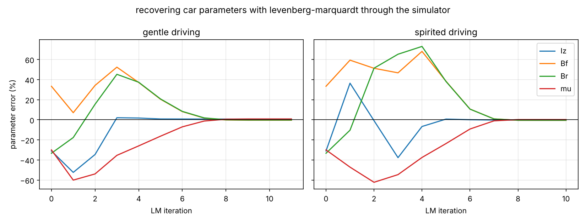
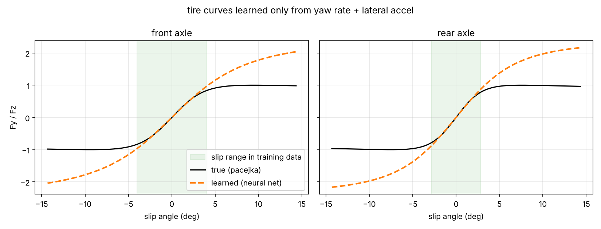
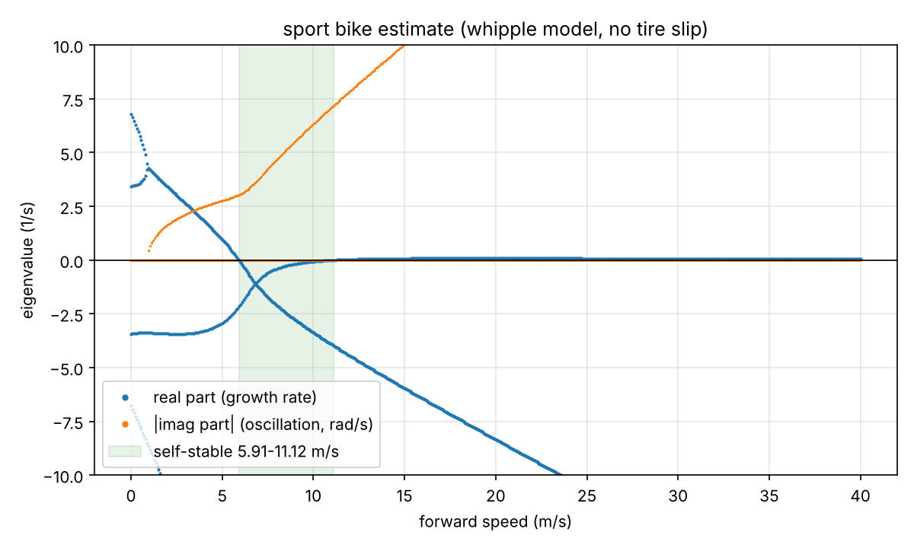
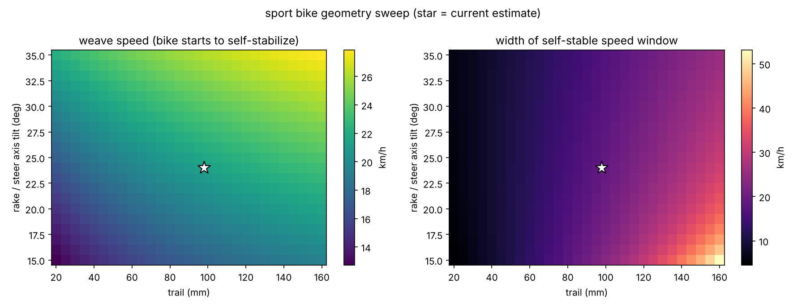
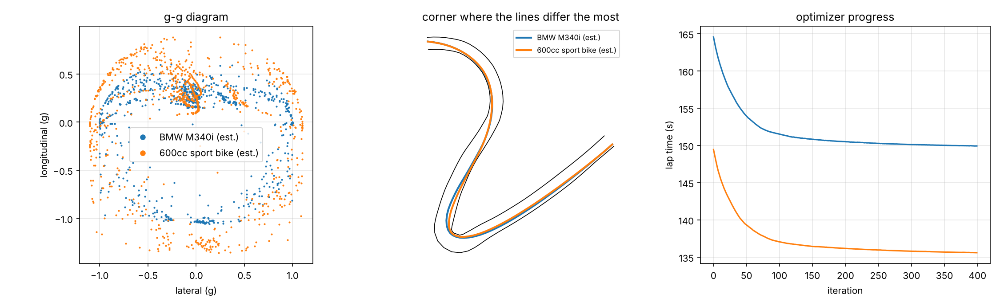

# vehicle-dynamics-diffsim


A differentiable vehicle dynamics simulator for cars and motorcycles, written in PyTorch. Every model in here (tires, car, bike, lap sim) is built out of torch ops, so you can backprop through a whole simulated drive and ask questions like "what tire parameters would make the sim match what my phone recorded" or "which way should I move the racing line to go faster", and get the answer with gradient descent.

This started from my robotics terrain research at Bucknell, where I work on learned contact models for wheels on soil. Same idea here, but the contact is tire on asphalt, and the vehicles are the ones I actually care about: a BMW (M340i / M240i, still deciding) and a sport bike.



## What's in here

| Module | What it does |
|---|---|
| `vdsim/tires.py` | Pacejka "magic formula" tire, linear tire, and a small neural net tire (forced to be odd symmetric) |
| `vdsim/car.py` | Kinematic and dynamic bicycle models, load transfer, friction ellipse on the rear, RK4 integrator, batched rollouts |
| `vdsim/whipple.py` | Linearized Whipple bike model (lean + steer), built from the 25 physical parameters, eigenvalue analysis, self-stable speed range |
| `vdsim/lapsim.py` | Quasi steady state lap time sim (point mass with a g-g ellipse), differentiable |
| `vdsim/track.py` | Loads real track centerlines + widths, curvature, smoothing |
| `vdsim/telemetry.py` | Loads phone recordings (Sensor Logger app) and figures out the phone's mounting angle from the data |
| `vdsim/params.py` | Parameter sets: M340i, M240i, the benchmark bicycle, a 600cc sport bike estimate |

## Running it

```
pip install -r requirements.txt
python data/get_tracks.py          # downloads track data (TUM racetrack database)
python -m pytest                   # 13 tests, about 15 s
python experiments/01_handling.py
python experiments/02_system_id.py       # ~3 min
python experiments/03_neural_tire.py     # ~12 min on cpu
python experiments/04_bike_stability.py
python experiments/05_racing_line.py Nuerburgring 400
```

Everything runs on CPU. Figures go to `figures/`.

## How I know it's right

Before trusting any of the fancy stuff, every model gets checked against something with a known answer (`tests/`):

- **Bicycle (Whipple) model.** I build the M, C1, K0, K2 matrices from the raw physical parameters instead of hard coding them, then compare to the published benchmark in Meijaard et al. (2007). All 12 entries match to better than 1e-9, and the self-stable speed range comes out as 4.2924 to 6.0243 m/s, same as the paper.
- **Car model.** With tiny steering inputs the tires are linear, so the steady state yaw rate has to match the closed form understeer gradient formula. Worst error across 18 to 180 km/h is 0.03%. At walking speed it also matches the kinematic model (no tires at all) within 2%.
- **Gradients.** d(yaw rate)/d(yaw inertia) from autograd matches a finite difference to 1e-4, after a 1 s rollout with 400 RK4 sub steps.
- **Lap sim.** On a constant radius circle the speed has to sit at sqrt(a_y,max R) the whole way, and it does.
- **Phone loader.** A fake Sensor Logger export with the phone mounted at a random 3D angle gets the yaw rate back within 0.001 rad/s and lateral accel within 0.05 m/s^2.

## Results and analysis

### 1. Car handling (`experiments/01_handling.py`)

With my M340i estimate (1745 kg, 2.851 m wheelbase, ~50/50 split) the model gives:

- understeer gradient **0.71 deg/g**, characteristic speed **171 km/h**
- cornering stiffness 139 kN/rad front, 173 kN/rad rear
- max steady lateral accel **0.95 g**, which is about where real M340i skidpad numbers land



The yaw gain plot was the most interesting part to me. With a tiny steer input the sim lands right on the linear theory. With a more realistic 0.5 deg input and drag turned on, it's **11% under** the theory at 180 km/h. I tracked it down to two things. First, 0.5 deg at 180 km/h is already 0.36 g, so the tires aren't really linear anymore. Second, aero drag means the rear wheels have to push ~1100 N just to hold speed, which shifts about 200 N of load off the front axle. That only changes the axle cornering stiffnesses by ~2%, but near the characteristic speed the yaw gain depends on the *difference* between the front and rear terms, so a 2% change turns into a ~20% change in the understeer gradient. Basically the car gets noticeably lazier to steer at high speed just from drag, which I didn't expect going in.



The handling diagram shows the linear model is fine up to about 0.5 g. After that the front tires start running out (they peak at 9.4 deg of slip vs 7.5 for the rear), understeer climbs fast, and past 6.5 deg of steer more steering actually gives *less* grip. That's front washout, the thing stability control is fighting.

### 2. System identification (`experiments/02_system_id.py`)

This is the core "differentiable" demo. I record what a phone would see (gyro yaw rate, lateral accel, GPS speed) from the sim with the true parameters plus realistic sensor noise, start the model 30-40% off, and fit yaw inertia Iz, the front and rear tire stiffness factors Bf and Br, and peak grip mu. The Jacobian of every residual with respect to every parameter comes from forward mode autodiff (`torch.func.jacfwd`) through the 2.5 s rollouts, and Levenberg-Marquardt does the fitting. It converges in about 10 iterations, ~1.5 min on a laptop CPU.

I also use J^T J at the optimum to get real error bars (it's the Fisher information since the residuals are already divided by the sensor noise), instead of just saying "it converged".



| dataset | peak a_y | Iz error | Bf error | Br error | mu error | corr(Bf, mu) |
|---|---|---|---|---|---|---|
| gentle | 0.28 g | +0.7 ± 0.7% | -0.4 ± 18.4% | -0.2 ± 18.4% | +0.8 ± 18.0% | -1.000 |
| spirited | 0.76 g | -0.3 ± 0.2% | -0.5 ± 0.4% | -0.5 ± 0.4% | +0.2 ± 0.3% | -0.910 |

The takeaway is about **identifiability**. Both fits land close to the truth, but look at the error bars. With gentle driving (never over 0.3 g) yaw inertia is pinned to under a percent, while the tire parameters have ±18% error bars and Bf and mu are correlated at -1.000. That makes sense: at small slip angles the tire force is just B*C*mu*Fz*alpha, so the data only pins down the *product* B*mu, and you can trade B against mu forever. The gentle fit landing near the true mu was basically luck with this noise draw, a different seed could put it 18% off and the data couldn't tell the difference. You only learn where the grip ends by driving near where the grip ends. The spirited data (up to 0.76 g) bends the tires over enough to separate B from mu, and every error bar drops under half a percent.

The first version of this used Adam and stalled about 5% off on the spirited data. It wasn't a bug, it was the same B*mu valley: the loss surface is a long narrow trench and Adam crawls along it. Switching to LM, which uses the Jacobian and sees the shape of the trench, fixed it. That's probably the most useful thing I learned building this.

That's also a real problem for doing this on my own car: the data I can collect safely on public roads is exactly the data that can't tell you the limit. More on that under "next steps".

### 3. Learning the tire curve with a neural net (`experiments/03_neural_tire.py`)

Same setup, but the Pacejka tires are replaced by two small MLPs (front and rear axle), and the only training signal is yaw rate and lateral accel. No force measurements at all. The gradient has to go back through the full rollout into the network weights.



Inside the slip range the training data covered (shaded), the learned curves sit right on top of the true ones (max error 0.09-0.13 Fy/Fz, at the very edge of the range). On a double lane change it never saw in training, the learned model tracks the true car within **0.11 m** over 131 m.

Outside the data it's a different story. The net thinks the tires keep gripping up to ~2 g, because nothing in the data told it otherwise. If you handed this model to the racing line optimizer it would happily plan corners at double the real grip. This is the classic problem with pure black box models in physics, and it's the reason the next version should be a hybrid: keep Pacejka's shape (which is guaranteed to saturate) and only let the net learn a correction on top of it.

### 4. Bike self-stability (`experiments/04_bike_stability.py`)



For my rough 600cc sport bike + rider estimate, the Whipple model says the bike balances itself between **21 and 40 km/h**. Above 40 km/h the capsize mode is technically unstable, but slowly, with a time constant of ~12 s at 72 km/h and ~15 s at 108 km/h. That's slow enough that you correct it without noticing, which lines up with how a bike actually feels at speed (it holds a lean, it just doesn't stand itself back up).



Sweeping trail and rake: more trail pushes the self-stable window wider and slightly higher in speed, and steeper rake (less steer axis tilt) with lots of trail gives the widest window. My sport bike estimate (98 mm trail, 24 deg) sits in the narrow-window part of the map, which makes sense since sport bikes are set up for quick turn in, not for being stable hands off. That's the tradeoff between stable and flickable, in one plot.

Big caveat: the Whipple model assumes the tires don't slip and the frame is rigid. That's fine for a pushbike, but on a motorcycle it misses wobble (the high frequency front end shake) completely. Getting that needs tire relaxation length and frame compliance (the Sharp 1971 model), which is on the list.

### 5. Racing line optimization (`experiments/05_racing_line.py`)

The line is the track centerline pushed sideways at every point. Lap time comes from the QSS lap sim, and since that's differentiable, d(lap time)/d(offset) tells every point of the line which way to move. Adam does the rest, 400 iterations, about 3 minutes.

| Nürburgring GP (5.14 km) | centerline | optimized | gain |
|---|---|---|---|
| M340i (est.) | 2:44.6 | **2:29.9** | 14.6 s |
| 600cc sport bike (est.) | 2:29.5 | **2:15.6** | 13.9 s |



Things I noticed:

- Neither vehicle had any idea what a racing line was. The out-in-out shape came purely from following the gradient of lap time, which honestly was a pretty cool thing to watch.
- The g-g plots show the main difference between them. The car's is a clean ellipse capped at 1 g. The bike's is taller on the braking side (it's limited by a stoppie at ~1.1 g, not tire grip) and shorter on the drive side at low speed (wheelie limit at ~0.95 g), but it has almost twice the power to weight ratio so it keeps accelerating harder at high speed.
- The bike is narrower so it gets ~1 m more usable track. The spot where the two lines split the most is the slow chicane in the middle figure, where the bike uses that extra width to straighten the S out.
- The g-g plots are a bit noisy since the accelerations come from finite differences on a 6 m grid.
- These lap times are for an estimated stock car with a point-mass model, no load transfer in the lap sim, no aero downforce. Real times for this kind of car are in the same ballpark, but I wouldn't read too much into the exact number.

One thing I had to fix to get this working: if Adam can move every point on its own, it makes the line wiggle point to point, and the lap sim reads each wiggle as a tiny corner. Blurring the optimization variable with a Gaussian (sigma = 18 m) before it becomes the line fixed it.

## Next steps

- [ ] Record my own drives and rides with Sensor Logger and run system ID on real data (`vdsim/telemetry.py` is ready for it). Normal road driving should pin down yaw inertia and the cornering stiffness (B*mu), and the limit stuff has to come from a track day or autocross
- [ ] Hybrid tire model: Pacejka + neural correction, so it can't invent grip it doesn't have
- [ ] Use the bicycle car model (not a point mass) inside the lap optimizer, optimizing steering + throttle directly
- [ ] Sharp 1971 motorcycle model with tire slip, to get the wobble mode
- [ ] Lap time vs lean angle limit for the bike (tie the bike lap sim to the Whipple geometry)
- [ ] Web viewer for laps

## References

- Pacejka, H. B. *Tire and Vehicle Dynamics*, 3rd ed. (2012)
- Meijaard, Papadopoulos, Ruina & Schwab, "Linearized dynamics equations for the balance and steer of a bicycle: a benchmark and review", Proc. R. Soc. A 463 (2007)
- Rajamani, R. *Vehicle Dynamics and Control*, 2nd ed. (2012)
- Track data: TUM racetrack database, github.com/TUMFTM/racetrack-database (LGPL-3.0), downloaded by `data/get_tracks.py`, not included in this repo

All car and bike parameters here are estimates from public spec sheets and textbook values, not measurements.
